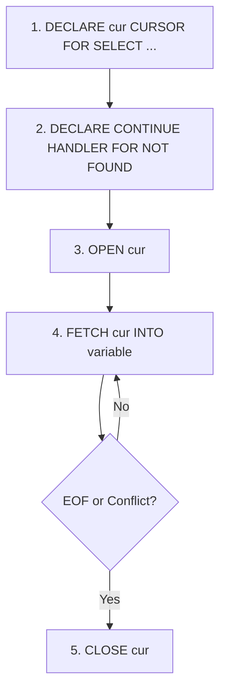

# Product Requirements Document (PRD)
## Project Name: UniBook — Campus Event & Venue Booking Dashboard
**Academic Focus**: Dual Course Submission (Object-Oriented Programming in Java & Relational Database Management Systems in MySQL)

---

## 1. Executive Summary & Objective
**UniBook** is an enterprise-grade campus venue and event booking management dashboard designed for university administrators, facility coordinators, and department heads. It enables real-time venue utilization tracking, conflict-free scheduling, event reservations, and operational analytics.

The system is architected to demonstrate full mastery of:
1. **Core Object-Oriented Programming (Java)**: Composition, Inheritance, Interfaces, Method Overloading, Custom Exception Handling, Synchronized Concurrency, Daemon Background Threads, and File I/O Streams.
2. **Relational Database Management Systems (MySQL)**: Strict Relational Integrity (PK/FK/CHECK/UNIQUE), B-Tree Indexing, Cursors within Stored Procedures, PL/SQL Automated Triggers, and Analytical Views with Outer Joins.

---

## 2. Target Users & Separation of Concerns

### 2.1 Campus Staff / Facility Administrators (Operational Dashboard)
- **Need**: Rapid overview of room availability, venue capacities, upcoming campus events, quick conflict-free reservations, and venue utilization stats.
- **Strict UI Directive**: The dashboard will display **only** clean business domain data (venues, bookings, capacities, event schedules). It will **never** display raw backend technical jargon, debug logs, or internal class structures on user-facing operational pages.

### 2.2 Academic Evaluators / Course Professors (Viva Demo Sandbox)
- **Need**: Direct, interactive verification of all syllabus-mandated OOP and RDBMS features.
- **Route**: A dedicated `/viva-demo` sandbox screen providing triggered execution and live telemetry for:
  - 10-thread concurrent collision simulation (testing Java `synchronized` blocks and race conditions).
  - File I/O receipt generator (`FileWriter`) and manifest loader (`BufferedReader`).
  - Direct execution of MySQL Stored Procedure with Cursor (`sp_check_availability`).
  - Direct trigger firing validation (`After_Booking_Insert`).
  - Raw query & view execution (`vw_venue_utilization`).

---

## 3. Strict UI / UX Design Specifications

| Attribute | Specification |
| :--- | :--- |
| **Theme** | Light Mode Enterprise Aesthetic |
| **Canvas Background** | `#F3F4F6` (Neutral Light Gray) |
| **Card / Surface Background** | `#FFFFFF` (Stark White) with `border border-gray-200` |
| **Typography** | Inter / System Sans-Serif, crisp weights (400, 500, 600), high legibility |
| **Primary Accent** | `#3B82F6` (Muted Executive Blue) for active links, primary indicators |
| **Secondary Accent** | `#F97316` (Warm Muted Orange) for actions, metrics, and highlights |
| **Text Primary** | `#111827` (Near-black charcoal) |
| **Text Muted** | `#6B7280` (Medium gray) |
| **Information Density** | High / Industrial / Financial terminal vibe. Compact padding, dense data tables, clear status chips (`Available`, `Occupied`, `Reserved`). |
| **Animations** | **Strictly snappy and instantaneous** (`transition-none` or sub-100ms linear ease). Zero bouncy, staggered, floating, or playful transitions. |
| **Navigation** | Persistent, slim left-hand icon sidebar with tooltip labels + clean sticky top header with global date and search. |

---

## 4. Operational Feature Specifications

### 4.1 Dashboard Overview (`/`)
1. **Executive Stat Cards**:
   - Total Campus Venues & Cumulative Capacity.
   - Total Bookings Today & Active Confirmed Reservations.
   - Peak Utilization Rate (% of rooms actively reserved).
   - Most Popular Venue (derived from database trigger counter).
2. **Venue Inventory & Utilization Grid**:
   - Card/List view of all campus venues with real-time status (`Available`, `Booked`).
   - Capacity meter, department assignment, and total lifetime bookings counter.
3. **Upcoming Events & Reservations Table**:
   - Chronological table of campus bookings with filtering by venue, date, and organizer.
4. **Instant Booking Modal**:
   - Date picker, venue dropdown, organizer selector.
   - Immediate feedback on conflict checks and reservation confirmation.

### 4.2 Venues Management (`/venues`)
- Comprehensive venue directory with capacity filters, room features, and utilization stats sourced directly from database views.

### 4.3 Bookings & Reservations (`/bookings`)
- Full ledger of campus bookings with search, date filters, status tracking, and download receipt button.

### 4.4 Academic Viva / Evaluator Sandbox (`/viva-demo`)
- Dedicated evaluative control panel with 3 primary test runners:
  1. **Concurrency Stress Test Runner**: Spawns 10 parallel threads attempting to reserve the exact same venue slot simultaneously. Shows live thread log and single-winner guarantee.
  2. **File I/O Stream Verification**: Displays manifest loaded via `BufferedReader` and allows downloading a cryptographically stamped booking receipt generated via `FileWriter`.
  3. **RDBMS Deep Inspection**: Directly invokes `sp_check_availability` stored procedure (cursor-driven) and checks the `After_Booking_Insert` trigger output.

---

## 5. Non-Functional Requirements
- **Performance**: Instantaneous page transitions; API responses < 150ms.
- **Data Integrity**: Zero race conditions allowed on venue reservation; database must enforce ACID compliance.
- **Portability**: Self-contained Java backend (JDK 17+) and standardized MySQL 8.0 schema scripts.

---

## 6. RDBMS Comprehensive Viva & Defense Revision Guide
> **Academic Note for Evaluation**: This section provides the complete theoretical foundation, SQL architectures, algorithmic trade-offs, and anticipated viva defense Q&A for the 7 interactive subheadings presented in the **Database Studio** (`/database`).

---

### 6.1 Subheading 1: Live Tables Explorer (Physical Storage & Relational Architecture)

#### 1. Core RDBMS Theory & Foundations
- **Relational Data Model**: Proposed by E.F. Codd (1970). Data is organized into mathematically grounded relations (tables), consisting of tuples (rows) and attributes (columns).
- **Physical vs. Logical Schemas**:
  - *Logical Schema*: The conceptual blueprint defining tables, columns, data types, and integrity constraints (`01_schema.sql`).
  - *Physical Schema*: How data pages and B-Tree nodes are physically serialized onto storage blocks by the storage engine (`.ibd` tablespace files in MySQL).
- **Storage Engine Choice: InnoDB vs. MyISAM**:
  - *Why InnoDB was selected for UniBook*:
    1. **ACID Transaction Support**: Provides atomic commits and rollbacks via Undo and Redo logs (`ib_logfile`).
    2. **Row-Level Locking**: High concurrency with fine-grained locks instead of table-level locking in MyISAM.
    3. **Foreign Key Referential Integrity**: Natively validates and enforces constraints with cascading actions (`ON DELETE CASCADE`).
    4. **Crash Recovery**: Doublewrite buffer and Write-Ahead Logging (WAL) prevent database corruption during sudden power losses.
- **SQL Language Subsets**:
  - **DDL (Data Definition Language)**: `CREATE`, `ALTER`, `DROP`, `TRUNCATE` (defines schema structure; auto-commits in MySQL).
  - **DML (Data Manipulation Language)**: `INSERT`, `UPDATE`, `DELETE` (modifies state; transaction-bound).
  - **DQL (Data Query Language)**: `SELECT` (retrieves and projects data).
  - **DCL (Data Control Language)**: `GRANT`, `REVOKE` (privilege and security management).

#### 2. Relational Schema Architecture in UniBook
The system manages three primary physical tables and one material audit/view relation:
1. **`organizers`**:
   - `organizer_id` INT AUTO_INCREMENT PRIMARY KEY
   - `name` VARCHAR(100) NOT NULL
   - `department` VARCHAR(100) NOT NULL
   - `contact_email` VARCHAR(120) NOT NULL
   - `created_at` TIMESTAMP DEFAULT CURRENT_TIMESTAMP
2. **`venues`**:
   - `venue_id` INT AUTO_INCREMENT PRIMARY KEY
   - `name` VARCHAR(100) NOT NULL UNIQUE
   - `building` VARCHAR(100) NOT NULL
   - `capacity` INT NOT NULL CHECK (capacity > 0)
   - `total_bookings` INT DEFAULT 0 (denormalized aggregate counter maintained by trigger)
   - `created_at` TIMESTAMP DEFAULT CURRENT_TIMESTAMP
3. **`bookings`**:
   - `booking_id` INT AUTO_INCREMENT PRIMARY KEY
   - `venue_id` INT NOT NULL (FK referencing `venues.venue_id`)
   - `organizer_id` INT NOT NULL (FK referencing `organizers.organizer_id`)
   - `event_name` VARCHAR(150) NOT NULL
   - `booking_date` DATE NOT NULL
   - `status` VARCHAR(20) DEFAULT 'CONFIRMED' CHECK (status IN ('CONFIRMED', 'CANCELLED', 'HOLD'))
   - `created_at` TIMESTAMP DEFAULT CURRENT_TIMESTAMP

#### 3. High-Probability Viva Questions & Model Answers
- **Q: What is the fundamental difference between `DELETE`, `TRUNCATE`, and `DROP`?**
  - **Model Answer**: `DELETE` is a logged DML operation that removes rows individually, fires `ON DELETE` triggers, and allows transaction rollbacks. `TRUNCATE` is a DDL operation that deallocates data pages, resets `AUTO_INCREMENT` counters, is faster, and does not fire row triggers. `DROP` is a DDL operation that removes both the table data and its schema definition completely from the data dictionary.
- **Q: Why are primary keys usually surrogate integers (`AUTO_INCREMENT`) instead of natural keys (like facility names)?**
  - **Model Answer**: Surrogate integer keys provide compact, fixed 4-byte identifiers. They preserve B-Tree clustered index efficiency (sequential append prevents index page fragmentation) and isolate primary keys from changing business realities (e.g., if a building or room is renamed, foreign key child records do not need cascade updates).

---

### 6.2 Subheading 2: ER Diagram & Schema (Relational Integrity, Constraints & Normalization)

#### 1. Entity-Relationship Modeling & Cardinality
```
+---------------+              +---------------+              +---------------+
|   ORGANIZER   | 1          N |    BOOKING    | N          1 |     VENUE     |
+---------------+--------------+---------------+--------------+---------------+
| organizer_id  |<------------ | organizer_id  | ------------>| venue_id      |
| name          |              | booking_id    |              | name          |
| department    |              | venue_id      |              | building      |
| contact_email |              | event_name    |              | capacity      |
+---------------+              | booking_date  |              | total_bookings|
                               | status        |              +---------------+
                               +---------------+
```
- **Entities**:
  - `Organizer`: Weak independent entity representing the academic host.
  - `Venue`: Physical campus asset entity.
  - `Booking`: Associative junction entity capturing the ternary event relationship between an Organizer, a Venue, and a Temporal coordinate (Date).
- **Cardinality Ratios**:
  - `organizers` to `bookings`: **1:N (One-to-Many)**. One department organizer can create multiple bookings; each booking belongs to exactly one organizer.
  - `venues` to `bookings`: **1:N (One-to-Many)**. One venue can accommodate multiple non-overlapping bookings across calendar dates.

#### 2. Relational Constraints & Data Integrity
1. **Domain Constraints**:
   - `capacity INT NOT NULL CHECK (capacity > 0)`: Enforces that facility capacity cannot be negative or zero.
   - `status VARCHAR(20) CHECK (status IN ('CONFIRMED', 'CANCELLED', 'HOLD'))`: Restricts lifecycle state to an enumerated set.
2. **Entity Integrity**:
   - `PRIMARY KEY` on every relation ensures that tuples are unique and non-null, creating a unique clustered search path.
3. **Referential Integrity & Cascading Actions**:
   - `CONSTRAINT fk_booking_venue FOREIGN KEY (venue_id) REFERENCES venues(venue_id) ON DELETE CASCADE`
   - *Why `ON DELETE CASCADE`?* If a venue is retired or physically demolished and removed from the system, its future reservations must automatically be purged, preventing orphaned child records.
4. **Relational Composite Uniqueness Constraint**:
   - `CONSTRAINT uq_venue_date UNIQUE (venue_id, booking_date)`:
   - **Academic Defense**: Guarantees at the relational storage layer that two concurrent threads or users can NEVER insert two bookings for the exact same venue on the exact same date. Even if application-level thread synchronization failed, the RDBMS rejects the second row with SQL error `1062 (Duplicate entry)`.

#### 3. Normalization Walkthrough (1NF -> 2NF -> 3NF)
- **1NF (First Normal Form)**:
  - *Criteria*: All attributes contain atomic (indivisible) scalar values; no repeating groups; unique column names.
  - *Compliance*: In UniBook, attendee lists, dates, and event tags are not combined into comma-delimited strings; each field is atomic.
- **2NF (Second Normal Form)**:
  - *Criteria*: Satisfies 1NF and contains **no partial functional dependencies** (every non-prime attribute is fully functionally dependent on the entire candidate key).
  - *Compliance*: In `bookings`, the surrogate key is `booking_id`. Venue metadata (`building`, `capacity`) is not stored in `bookings`; it resides exclusively in `venues`. Thus, no non-key attribute depends on only part of any composite key.
- **3NF (Third Normal Form)**:
  - *Criteria*: Satisfies 2NF and contains **no transitive functional dependencies** ($X \rightarrow Y$ and $Y \rightarrow Z$, where non-key determines non-key).
  - *Compliance*: An organizer's department and email depend strictly on `organizer_id`. Storing `department` inside `bookings` would create a transitive dependency (`booking_id -> organizer_id -> department`). By decomposing into `organizers`, 3NF is preserved.
- **Controlled Denormalization Rationale**:
  - `venues.total_bookings`: Represents a stored derived aggregate. Rather than executing an expensive `SELECT COUNT(*)` across the million-row `bookings` table on every dashboard page load, this counter provides an $O(1)$ read. It is strictly maintained in lock-step by an automated database trigger (`After_Booking_Insert`).

#### 4. High-Probability Viva Questions & Model Answers
- **Q: What is a partial vs transitive dependency?**
  - **Model Answer**: A partial dependency occurs when a non-key attribute depends on only a subset of a composite primary key. A transitive dependency occurs when a non-key attribute depends on another non-key attribute rather than directly on the primary key ($A \rightarrow B \rightarrow C$).
- **Q: Why not normalize everything to Boyce-Codd Normal Form (BCNF) or 4NF?**
  - **Model Answer**: Over-normalization increases table fragmentation and requires excessive multi-table `JOIN` operations, increasing query latency and disk I/O. 3NF strikes the optimal balance between eliminating insertion/deletion/update anomalies and preserving real-time query throughput.

---

### 6.3 Subheading 3: PL/SQL Trigger (`After_Booking_Insert`)

#### 1. Theoretical Architecture of Triggers
- **Definition**: A trigger is a specialized stored program associated with a database table that executes automatically in response to specified DML events (`INSERT`, `UPDATE`, `DELETE`).
- **Event-Condition-Action (ECA) Model**:
  - *Event*: `INSERT ON bookings`
  - *Condition*: Implicitly evaluated for every newly committed row (`FOR EACH ROW`).
  - *Action*: Procedural `UPDATE venues SET total_bookings = total_bookings + 1`.
- **Classification of Triggers**:
  - **Timing**: `BEFORE` (ideal for input validation, sanitization, default assignment) vs. `AFTER` (ideal for auditing, cascade updates, denormalized aggregate recalculation).
  - **Granularity**: `FOR EACH ROW` (row-level; executes once for each modified tuple) vs. `STATEMENT` (executes once per SQL statement regardless of how many rows were affected).
- **Pseudo-Records**:
  - `NEW`: Read-only (in AFTER) or writable (in BEFORE) pseudo-record containing the values of the new row being inserted or updated.
  - `OLD`: Read-only pseudo-record containing the values of the row before update or deletion.

#### 2. Trigger Code Analysis (`03_triggers.sql`)
```sql
DELIMITER //

CREATE TRIGGER After_Booking_Insert
AFTER INSERT ON bookings
FOR EACH ROW
BEGIN
    UPDATE venues 
    SET total_bookings = total_bookings + 1 
    WHERE venue_id = NEW.venue_id;
END //

DELIMITER ;
```
- **Execution Flow**:
  1. A user books `Turing Grand Auditorium` (`venue_id = 1`).
  2. The application executes `INSERT INTO bookings (...) VALUES (1, ...)`.
  3. The storage engine completes the insert into the `bookings` data pages.
  4. Immediately before the transaction completes, the DBMS invokes `After_Booking_Insert`.
  5. The trigger inspects `NEW.venue_id` (1) and increments `total_bookings` in `venues`.
  6. Both the insertion and the counter increment commit atomically within the same transaction.

#### 3. High-Probability Viva Questions & Model Answers
- **Q: Why is `AFTER INSERT` preferred over `BEFORE INSERT` for this counter?**
  - **Model Answer**: Because the counter update is a side-effect that depends on the successful persistence of the booking. If `BEFORE INSERT` were used, and the insert subsequently failed due to a constraint violation (e.g. duplicate key), the counter would have incremented for a booking that never existed.
- **Q: Can a trigger abort or roll back a transaction?**
  - **Model Answer**: Yes. In MySQL, executing `SIGNAL SQLSTATE '45000' SET MESSAGE_TEXT = 'Error message'` inside a trigger raises an unhandled exception that causes the DBMS to immediately roll back the entire transaction.
- **Q: What is a mutating table error?**
  - **Model Answer**: A mutating table error (frequent in Oracle PL/SQL) occurs when a row-level trigger attempts to query or modify the very table that caused the trigger to fire. In MySQL, `AFTER INSERT` avoids this by updating the referenced `venues` table rather than the mutating `bookings` table.

---

### 6.4 Subheading 4: Views & Outer Joins (`vw_venue_utilization`)

#### 1. SQL View Concept & Advantages
- **Definition**: A view is a stored SQL query that acts as a virtual table. It does not physically duplicate data on disk; rather, the DBMS merges the view definition with incoming queries dynamically (the `MERGE` algorithm) or constructs a temporary table (the `TEMPTABLE` algorithm).
- **Key Architectural Advantages**:
  1. **Abstraction & Simplification**: Encapsulates complex multi-table joins and aggregation math into a clean, simple interface (`SELECT * FROM vw_venue_utilization`).
  2. **Security & Column Masking**: Allows granting access to analytical metrics without exposing sensitive internal columns or customer PII.
  3. **Consistency**: Establishes a single authoritative mathematical formula for key performance indicators (e.g., utilization rate).

#### 2. Outer Joins vs. Inner Joins Mechanics
```sql
CREATE OR REPLACE VIEW vw_venue_utilization AS
SELECT 
    v.venue_id, 
    v.name AS venue_name, 
    v.building,
    v.capacity, 
    v.total_bookings AS lifetime_bookings,
    COUNT(b.booking_id) AS current_active_bookings,
    ROUND((COUNT(b.booking_id) / 30.0) * 100, 1) AS monthly_utilization_rate
FROM venues v
LEFT OUTER JOIN bookings b 
    ON v.venue_id = b.venue_id 
    AND b.status = 'CONFIRMED'
GROUP BY 
    v.venue_id, 
    v.name, 
    v.building, 
    v.capacity, 
    v.total_bookings;
```
- **Comparison**:
  - `INNER JOIN`: Preserves only tuples where the join predicate `v.venue_id = b.venue_id` evaluates to TRUE for both tables.
  - `LEFT OUTER JOIN`: Preserves **all tuples from the left relation (`venues`)**, regardless of whether any matching rows exist in the right relation (`bookings`). For venues with zero bookings, all attributes from `bookings` evaluate to `NULL`.
- **Critical Viva Defense**:
  - *Why not use an INNER JOIN?* If `INNER JOIN` were used, newly constructed campus venues or rooms with 0 scheduled bookings would be filtered out and completely omitted from the administrative dashboard! `LEFT OUTER JOIN` guarantees complete facility inventory visibility.

#### 3. Aggregation & `GROUP BY` Semantics
- `COUNT(b.booking_id)` vs `COUNT(*)`:
  - `COUNT(*)` counts all matching rows in the partitioned group, including `NULL` rows. For an unbooked venue, `COUNT(*)` would evaluate to 1!
  - `COUNT(b.booking_id)` evaluates the expression and ignores `NULL` entries, correctly returning `0` for unbooked rooms.
- **SQL-92 Standard Requirement**: Any column appearing in the `SELECT` list that is not encapsulated in an aggregate function (`COUNT`, `SUM`, `AVG`, `MAX`, `MIN`) MUST be included in the `GROUP BY` clause.

#### 4. High-Probability Viva Questions & Model Answers
- **Q: What is the difference between `WHERE` and `HAVING`?**
  - **Model Answer**: `WHERE` filters individual tuples *before* any grouping or aggregation takes place. `HAVING` filters aggregated groups *after* the `GROUP BY` operation has computed group metrics (e.g., `HAVING COUNT(b.booking_id) > 5`).
- **Q: Is a view updatable (can you run `UPDATE vw_venue_utilization ...`)?**
  - **Model Answer**: Generally no. In MySQL, views containing aggregate functions (`COUNT`), `GROUP BY`, `DISTINCT`, `HAVING`, or `UNION` are not updatable because the DBMS cannot deterministically map a change in an aggregated virtual row back to a single unique physical tuple in the underlying table.

---

### 6.5 Subheading 5: Cursor Stored Procedure (`sp_check_availability`)

#### 1. Procedural SQL & Stored Procedures
- **Stored Procedure vs. Stored Function**:
  - *Stored Procedure*: Executed via `CALL sp_name(...)`. Can return zero, one, or multiple results via `OUT` or `INOUT` parameters. Can perform transactions, commits, rollbacks, and DDL/DML.
  - *Stored Function*: Executed inline within SQL statements (e.g. `SELECT fn_name(...)`). Must return a single scalar value. Cannot commit or modify transactional state.
- **Declarative SQL vs. Procedural Cursors**:
  - *Declarative SQL*: Expresses *what* data to retrieve in bulk set operations (relational calculus/algebra).
  - *Procedural Cursors*: Imperative construct that provides *how* to navigate through a result set tuple-by-tuple.

#### 2. The 5-Stage Cursor Lifecycle in MySQL

1. **Declaration (`DECLARE`)**: Defines the name of the cursor and binds it to a SQL `SELECT` statement.
2. **Handler Specification (`DECLARE CONTINUE HANDLER`)**: Defines the runtime action when the cursor reaches the end of the result set (`NOT FOUND`).
3. **Initialization (`OPEN`)**: Executes the associated query, materializes or allocates the cursor result set, and positions the cursor pointer before the first row.
4. **Retrieval (`FETCH`)**: Reads the current row into local program variables and advances the internal pointer to the next record.
5. **Termination (`CLOSE`)**: Releases temporary cursor memory and system resources.

#### 3. Code Walkthrough (`05_procedures.sql`)
```sql
CREATE PROCEDURE sp_check_availability(
    IN p_venue_id INT, 
    IN p_date DATE, 
    OUT p_is_available BOOLEAN
)
BEGIN
    DECLARE done INT DEFAULT FALSE;
    DECLARE b_date DATE;
    
    DECLARE cur CURSOR FOR 
        SELECT booking_date 
        FROM bookings 
        WHERE venue_id = p_venue_id 
          AND status = 'CONFIRMED';
          
    DECLARE CONTINUE HANDLER FOR NOT FOUND SET done = TRUE;

    SET p_is_available = TRUE;

    OPEN cur;

    read_loop: LOOP
        FETCH cur INTO b_date;
        
        IF done THEN
            LEAVE read_loop;
        END IF;
        
        IF b_date = p_date THEN
            SET p_is_available = FALSE;
            LEAVE read_loop;
        END IF;
    END LOOP;

    CLOSE cur;
END //
```
- **Algorithm Analysis**:
  - The procedure accepts an input venue and requested reservation date.
  - It opens cursor `cur` filtering confirmed bookings for that venue.
  - If any row matches `p_date`, it flips `p_is_available` to `FALSE` and immediately breaks out of the loop using `LEAVE read_loop`, demonstrating efficient short-circuit iteration.

#### 4. High-Probability Viva Questions & Model Answers
- **Q: Why are cursors generally avoided in high-volume production systems, and why did you use one here?**
  - **Model Answer**: Cursors process tuples sequentially (row-by-row), creating memory overhead and defeating database set-based query optimizer engines that execute vectorised batch scans. We implemented it here to demonstrate mastery of procedural PL/SQL programming, cursor lifecycle management, and error handler control in our academic viva.
- **Q: What is a `CONTINUE HANDLER`?**
  - **Model Answer**: It is an exception handler in MySQL stored programs. When the condition `NOT FOUND` (SQLSTATE '02000') occurs upon reading past the last row of the cursor, the handler sets `done = TRUE` and execution continues without throwing a fatal runtime error.

---

### 6.6 Subheading 6: B-Tree Indexes (Data Structures & Performance Tuning)

#### 1. Indexing Theory & Search Tree Mechanics
- **Problem Statement**: Without an index, finding a booking for a specific date requires an $O(N)$ **Full Table Scan**, reading every single disk page allocated to the table.
- **B-Tree Structure**:
  - A self-balancing $m$-way search tree.
  - Every node has at most $m$ children.
  - All leaf nodes are located at the exact same depth (balanced height).
  - Search, insertion, and deletion time complexity: $O(\log N)$ disk page access operations.
- **Clustered vs. Secondary (Non-Clustered) Indexes**:
  - **Clustered Index**: In InnoDB, the primary key *is* the clustered index. The leaf pages contain the complete, physical row data. Every table has exactly one clustered index.
  - **Secondary Index**: An auxiliary B-Tree index built on non-primary columns (e.g. `booking_date`). Leaf nodes contain the indexed key value and the corresponding Primary Key pointer. Looking up a row via a secondary index performs an **Index Lookup** followed by a **Bookmark Lookup (Clustered Index Traversals)**.

#### 2. UniBook Index Architecture (`02_indexes.sql`)
1. **`CREATE INDEX idx_booking_date ON bookings(booking_date);`**
   - *Purpose*: Optimizes calendar queries, date range lookups (`WHERE booking_date BETWEEN ? AND ?`), and sorting (`ORDER BY booking_date ASC`).
2. **`CREATE INDEX idx_venue_id ON bookings(venue_id);`**
   - *Purpose*: Prevents full scans during relational joins (`ON v.venue_id = b.venue_id`).
3. **`CREATE INDEX idx_status_date ON bookings(status, booking_date);`**
   - *Purpose*: Composite index supporting administrative queries filtering active bookings by date.
   - **Leftmost Prefix Rule**:
     - Query with `WHERE status = 'CONFIRMED' AND booking_date = '2026-10-26'` uses the full composite index.
     - Query with `WHERE status = 'CONFIRMED'` uses the index (matches leftmost prefix).
     - Query with *only* `WHERE booking_date = '2026-10-26'` CANNOT utilize `idx_status_date`, which is why the standalone `idx_booking_date` was intentionally declared!

#### 3. Index Overhead & Trade-Offs
| Operation | Impact of Indexes | Technical Justification |
| :--- | :--- | :--- |
| `SELECT` | **Dramatically Faster** ($O(\log N)$) | B-Tree navigates directly to target leaf nodes; avoids scanning full tablespace. |
| `INSERT` | **Slight Overhead** | Every new row requires inserting a new key into the B-Tree, potentially triggering page splits. |
| `DELETE` | **Slight Overhead** | Deleting a record requires node pruning or underflow merging in the B-Tree. |
| `UPDATE` | **Conditional Overhead** | Fast to find the record, but if an indexed column is modified, the B-Tree must be restructured. |

#### 4. High-Probability Viva Questions & Model Answers
- **Q: How does the MySQL Query Optimizer decide whether to use an index?**
  - **Model Answer**: The optimizer calculates a cost-based estimate (number of disk I/O page reads). If a query matches 30% or more of the table rows, the optimizer may decide that a sequential Full Table Scan is faster than performing thousands of random secondary index lookups and bookmark traversals.
- **Q: What is a Covering Index?**
  - **Model Answer**: A covering index is an index that includes all the columns requested in the query's `SELECT`, `WHERE`, and `JOIN` clauses. Because the index contains all required data, the query engine completes using only the index tree, eliminating the need to read the physical table pages entirely.

---

### 6.7 Subheading 7: Interactive SQL Console & ACID Transactions

#### 1. ACID Properties Detailed Breakdown
The four pillars of reliable relational database transactions:
1. **Atomicity (All-or-Nothing)**:
   - A sequence of operations either completely succeeds or is completely undone.
   - *UniBook Example*: When reserving a facility, inserting the booking into `bookings` and incrementing `venues.total_bookings` occur in a single atomic unit. If a database failure occurs mid-flight, the **Undo Log** rolls back all intermediate changes.
2. **Consistency (State Preservation)**:
   - The database moves from one valid state satisfying all invariants to another valid state.
   - *UniBook Example*: Relational constraints (`CHECK (capacity > 0)`, `UNIQUE (venue_id, booking_date)`) are strictly checked before committing. No illegal or double-booked state can persist.
3. **Isolation (Concurrency Shielding)**:
   - Concurrent execution of transactions yields the same state as if they were executed sequentially.
   - Controlled via lock modes and MVCC (Multi-Version Concurrency Control).
4. **Durability (Survivability)**:
   - Once a transaction commits, its effects persist permanently even in the event of an operating system crash.
   - Guaranteed through the **Write-Ahead Log (WAL / Redo Log)**. Transactions are flushed to sequential disk logs before data pages are written to tablespace.

#### 2. ANSI SQL Transaction Isolation Levels & Concurrency Anomalies
| Isolation Level | Dirty Read | Non-Repeatable Read | Phantom Read | Mechanism |
| :--- | :---: | :---: | :---: | :--- |
| **Read Uncommitted** | Permitted | Permitted | Permitted | Queries read uncommitted row modifications from other transactions. |
| **Read Committed** | **Prevented** | Permitted | Permitted | Queries only read committed data. A new snapshot is generated on each query. |
| **Repeatable Read** *(MySQL Default)* | **Prevented** | **Prevented** | **Prevented*** | Snapshot created at start of transaction. InnoDB uses Next-Key locks to prevent phantoms. |
| **Serializable** | **Prevented** | **Prevented** | **Prevented** | Strict serial execution using shared read locks across query ranges. |

- **Anomaly Definitions**:
  - *Dirty Read*: Transaction A reads data modified by Transaction B that has not yet been committed (and could be rolled back).
  - *Non-Repeatable Read*: Transaction A reads a row, Transaction B modifies or deletes that row and commits, Transaction A re-reads the row and gets different data.
  - *Phantom Read*: Transaction A queries a range of rows (`WHERE booking_date = ...`), Transaction B inserts a new row matching that range and commits, Transaction A re-queries and sees a "phantom" new row.

#### 3. High-Probability Viva Questions & Model Answers
- **Q: What is the default isolation level in MySQL InnoDB, and how does it prevent phantom reads?**
  - **Model Answer**: The default isolation level is **Repeatable Read**. MySQL InnoDB prevents phantom reads without the performance penalty of Serializable through a combination of **MVCC (Multi-Version Concurrency Control)** for consistent non-locking reads, and **Next-Key Locking** (which locks both the index record and the gap before it) during locking reads (`SELECT ... FOR UPDATE`).
- **Q: What happens when two users attempt to book the exact same room at the exact same millisecond?**
  - **Model Answer**: At the application layer, our Java `synchronized processBooking()` method serializes access so only one thread executes the check and insert at a time. At the database layer, the unique constraint `uq_venue_date UNIQUE (venue_id, booking_date)` and row-level locks enforce that the first transaction successfully commits, while the second transaction encounters a constraint violation and is rolled back.

---

### 6.8 Viva Defense Quick Reference Cheat-Sheet
| Topic | Relevant File | Key Concept to State |
| :--- | :--- | :--- |
| **Schema & DDL** | `database/01_schema.sql` | InnoDB engine, surrogate keys, `ON DELETE CASCADE`, domain `CHECK` constraints. |
| **B-Tree Indexing** | `database/02_indexes.sql` | $O(\log N)$ search complexity, secondary index bookmark lookups, leftmost prefix rule. |
| **PL/SQL Trigger** | `database/03_triggers.sql` | `AFTER INSERT`, `NEW` pseudo-record, automated denormalized aggregate maintenance. |
| **Views & Outer Joins** | `database/04_views.sql` | `LEFT OUTER JOIN` preserves 0-booking rooms, `GROUP BY`, non-materialized abstraction. |
| **Cursor Procedure** | `database/05_procedures.sql` | 5-stage lifecycle (`DECLARE`, `CONTINUE HANDLER`, `OPEN`, `FETCH`, `CLOSE`), sequential evaluation. |
| **ACID & Concurrency** | Backend & SQL Engine | Atomicity via Undo Logs, Durability via Redo Logs (WAL), Repeatable Read isolation. |

